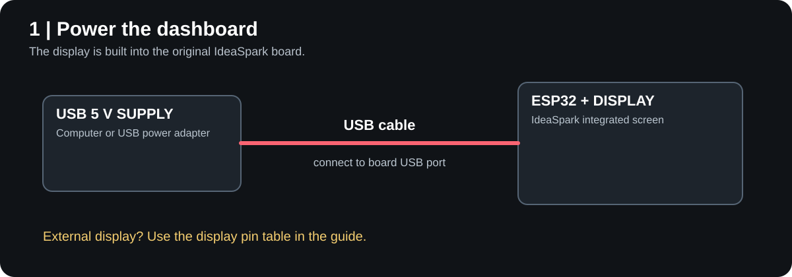
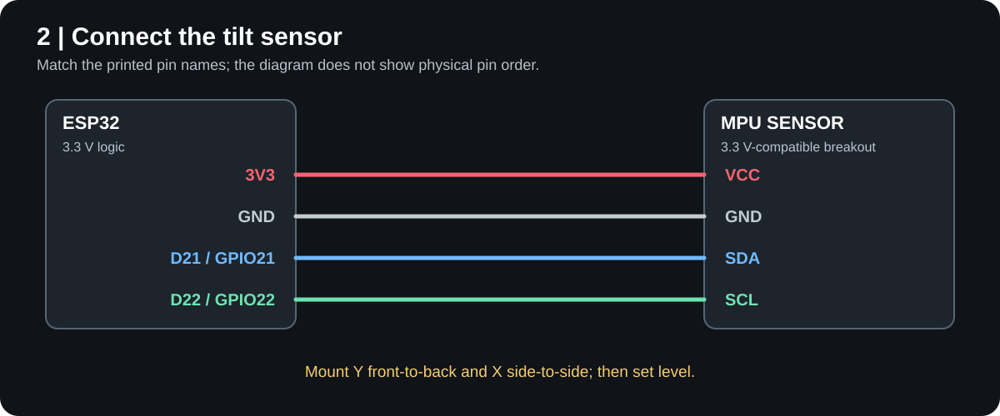
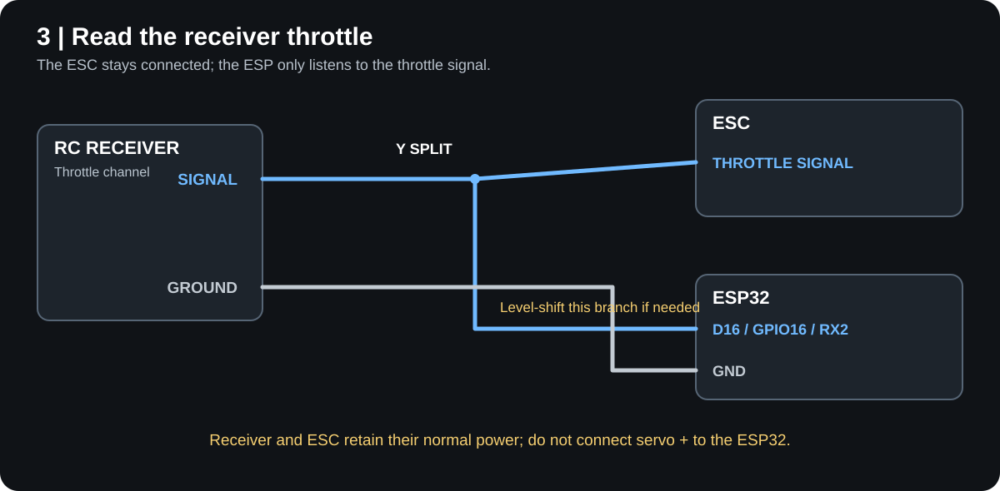
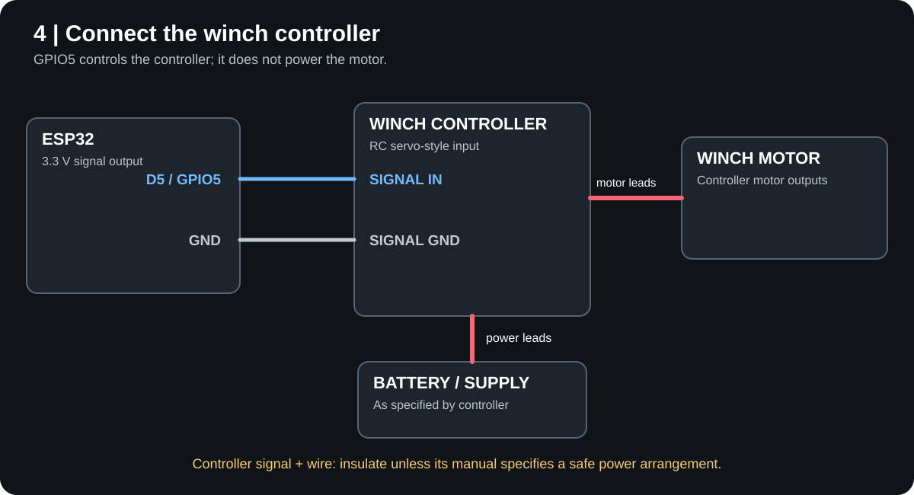
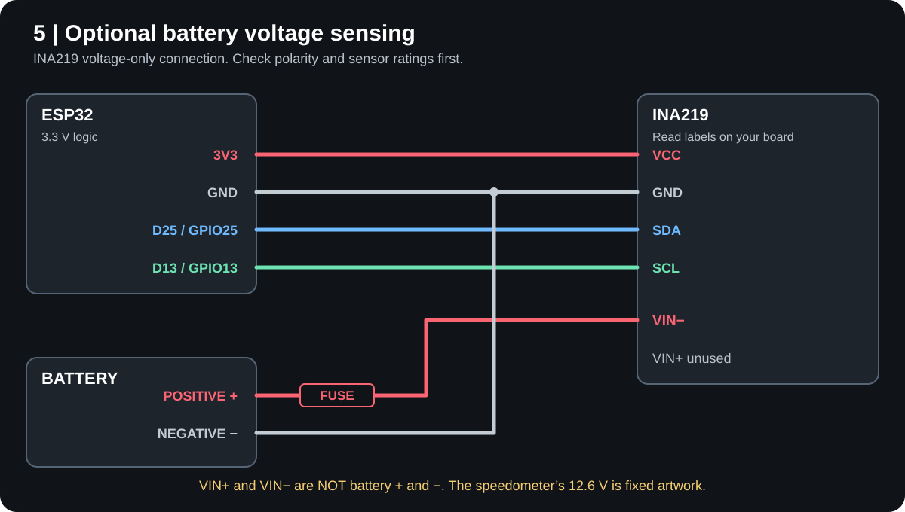

# Build a Magoo RC dashboard

This guide documents the hardware and firmware in this repository. The basic dashboard works on its own; the tilt sensor, throttle input, winch controller, and INA219 are separate additions. Connect and test one addition at a time.

The diagrams show **electrical connections**, not physical pin locations. A dot marks connected wires; crossing lines without a dot are separate. Read the pin labels on your parts: connector positions and wire colors vary by manufacturer.

## Parts and tools

| Item | Purpose |
| --- | --- |
| IdeaSpark ESP32-WROOM-32 board with built-in 1.14-inch, 240 × 135 ST7789 display | Dashboard; this firmware's display pins are configured for this board. |
| USB cable and 5 V USB supply or computer | Power and program the ESP32 during setup. |
| MPU-6050-compatible breakout with 3.3 V-compatible I²C | Optional pitch and roll display. |
| RC receiver, transmitter, and a servo Y cable | Optional throttle signal. The receiver and its ESC remain powered as specified by their manufacturer. |
| RC winch and a **servo-signal-compatible winch controller** | Optional winch operation from the app. Controller specifications must support the control signal described below. |
| INA219 breakout and fused, insulated voltage-sense connection | Optional experimental battery-voltage input; see the limitations in step 5. |
| Jumper wires, insulated connectors, and a multimeter | Connect and check the circuits. |

The original build used an IdeaSpark integrated-display board, an MPU-compatible sensor, an ordinary RC receiver, and an unidentified winch controller. Other modules can have different pin orders, voltage requirements and mounting orientations. **Read the labels and specifications for your exact parts; do not connect by wire color alone.**

### Before connecting anything

1. Disconnect USB and the vehicle battery while making or changing connections.
2. ESP32 GPIO uses 3.3 V logic. Never connect a battery, motor, 5 V receiver output, or servo power wire directly to a GPIO. Check the receiver's signal level; use an appropriate level shifter if it exceeds the ESP32's input limits. An ordinary multimeter may not capture the peak of a pulsed signal—check the receiver's specifications or use an oscilloscope.
3. The ESP32 cannot power a motor or winch. Use the winch controller and its specified power supply. Never connect the winch motor to a GPIO.
4. Power all I²C pull-ups at 3.3 V. Breakout-board regulator and pull-up arrangements differ, so verify the module before connecting it.

## 1. Prepare and power the ESP32



The IdeaSpark board has the display connected internally. No external display wiring is needed for this board. For a different ESP32 and ST7789 module, confirm that the module's power and logic are 3.3 V compatible and wire it according to `include/BoardConfig.h`:

| Display function | ESP32 GPIO |
| --- | --- |
| MOSI / data | 23 |
| SCLK / clock | 18 |
| CS / chip select | 15 |
| DC / data-command | 2 |
| Reset | 4 |
| Backlight | 32, active high |

These pins are already used by the integrated screen. Different board revisions may wire the screen differently. The original hardware is an 8 MB ESP32 even though PlatformIO's generic `esp32dev` configuration reports 4 MB; preserve an existing board's partition table and settings when updating it.

Install Python and PlatformIO, open a terminal in this repository, and build with `python -m platformio run`. For a **new or deliberately erased compatible board**, connect it to USB, identify its serial port, and run:

```powershell
python -m platformio run -t upload --upload-port COM3
```

Replace `COM3` with your board's actual port (for example, `/dev/ttyUSB0` on Linux). PlatformIO's upload writes the configured bootloader, partition table and application. The board configuration targets the original IdeaSpark hardware; a different board or partition layout may require changes first. **An application-only update is not a complete installation on a blank chip.** See the project README before updating an existing installation; preserve its partition table and settings. A flash erase removes saved Wi-Fi and calibration settings.

Connect the ESP32 to USB power. Its display should boot into the dashboard. The web dashboard's sleeping page is separate from the physical display. The setup access point is named `MagooESP`; check the configured password in `src/PhoneControl.cpp`. In the sanitized public snapshot, replace the placeholder password with your own before building. Connect to it and open `http://192.168.4.1`, then choose the app or the web dashboard.

## 2. Add the tilt sensor



With power disconnected, wire the breakout by its printed pin names:

```text
    ESP32                         MPU-compatible sensor
    3V3  ----------------------->  VCC  (3.3 V compatible)
    GND  ----------------------->  GND
    D21 / GPIO21  -------------->  SDA
    D22 / GPIO22  -------------->  SCL
```

Mount the board securely and flat, with the sensor's **Y axis front to back** and **X axis side to side** on the crawler. Use the axis markings on your module, not the connector's direction, to orient it. The firmware maps Y to pitch and X to roll. With the crawler level and still, open **Incline → Set level**. Tilt the vehicle gently front-to-back and side-to-side to confirm the corresponding reading changes. Calibration is saved on the ESP32; repeat after moving the sensor.

The firmware probes I²C addresses `0x68` and `0x69` and supports standard MPU-6050 identity as well as the identity reported by the original sensor. Pitch and roll are approximate and can be disturbed by vibration or acceleration. If the axis or sign is wrong, first check mounting and recalibrate; a differently oriented module may require a firmware change.

## 3. Add the receiver throttle signal



The dashboard **listens** to the receiver's throttle channel; it does not replace the ESC. Use a servo Y cable to keep the ESC connected to the same throttle output:

```text
                            +----> ESC throttle input (existing connection)
 Receiver throttle channel -+
                            +----> ESP32 D16 / GPIO16 / RX2 (signal only*)

 Receiver ground ----------------> ESP32 GND (common ground)
```

\* The branch to GPIO16 must be 3.3 V-compatible. If the receiver signal exceeds the ESP32 input range, insert a suitable level shifter in that branch. Confirm that the ESC still receives the receiver's original signal. Connect grounds together; **do not connect the receiver's positive servo-power lead to a GPIO or to the ESP32's 3V3 pin**. The receiver/ESC should retain their normal power arrangement.

1. Identify the receiver's throttle-channel **signal** and **ground** by its documentation or labels; servo plug pin orders differ.
2. After wiring, power the system with the wheels clear or the drive motor disconnected. Confirm the dashboard reports a receiver signal.
3. Under **Settings → Gear indicator**, release the throttle and choose **Set neutral**. Hold the forward command and choose **Set forward**. Settings are saved across reboots.

The input accepts conventional RC pulse widths from approximately 800 to 2,200 µs; a serial receiver protocol is not supported on this input. The displayed speed, RPM and five gears are simulated from throttle commands, not measured wheel speed, actual RPM or actual gears.

## 4. Add the winch controller



This connection is for a controller that accepts a conventional 3.3 V RC servo-style control signal. The original controller's make and model were not identified, so check your controller's documentation before copying this setup.

```text
 ESP32 D5 / GPIO5 ------> Winch controller SIGNAL input
 ESP32 GND  ------------> Winch controller signal GROUND

 Battery / power source --> Winch controller power input --> Winch motor
                            (according to its own manual)
```

The ESP32 sends a 50 Hz control signal: 1,500 µs is stop; at full command the two directions are approximately 1,100 and 1,900 µs. GPIO5 supplies the **signal only**. The controller supplies motor power. If the controller exposes a positive wire in its signal plug, insulate it unless the controller's instructions specify an appropriate power arrangement; do not connect it to an ESP32 GPIO or 3V3. Avoid joining independent power outputs. If the controller requires a higher signal voltage or a different protocol, use a suitable interface or controller instead.

Power the ESP32 and controller, with the winch line unloaded and clear. In the app or web dashboard, briefly hold **Out**, release, and confirm it stops; repeat for **In**. If the directions are reversed, use **Winch settings → Reverse winch direction**. Check that the controller stops when a command is released or connectivity is lost: the firmware commands neutral after roughly 900 ms without a refreshed movement command, but actual controller behavior depends on the hardware. Some controllers only move at full speed; intermediate commands are not guaranteed to give variable speed.

## 5. Optional: connect an INA219 voltage sensor



**Current firmware limitation:** the speedometer's battery icon and `12.6V` text are fixed artwork. They do not prove that a sensor is connected or a battery is charged. The firmware separately reads an INA219's bus-voltage register and reports it through the `/status` API when detected. Verify with a multimeter; do not use the on-screen 12.6 V as a battery monitor.

First connect the INA219's logic pins by their printed labels:

```text
    ESP32                         INA219 logic pins
    3V3  ----------------------->  VCC
    GND  ----------------------->  GND
    D25 / GPIO25  -------------->  SDA
    D13 / GPIO13  -------------->  SCL
```

For **voltage sensing only**, the INA219's bus voltage is measured at `VIN−` relative to its logic `GND`:

```text
 Battery negative (-) -----------> ESP32 GND / INA219 GND (common ground)
 Battery positive (+) -- fuse ---> INA219 VIN−
                                  INA219 VIN+ left unused
```

Use an insulated, appropriately fused sensing connection rated for the pack, with the fuse near its source. Confirm battery polarity and full-pack voltage with a meter before connecting: balance connectors can include intermediate cell taps, and colors are not a reliable pinout. The INA219's specified bus range is 0–26 V relative to ground; keep both sensor inputs within the device and breakout limits, including a fully charged pack. Do not connect battery positive to ESP32 GPIO, 3V3 or GND. **Do not put battery positive on one INA219 screw terminal and battery negative on the other**: those terminals are linked by a low-value current-sense resistor.

This arrangement senses voltage; it does not measure motor current. A current-measuring installation places the shunt in series with a load and needs a suitably rated shunt, wiring, and connectors. Do not run a crawler's drive or winch current through this small breakout without independently engineering and rating that circuit.

With power restored, open `http://192.168.4.1/status` while connected to the setup network, or replace the address with the ESP32's current network address. `batterySensorOnline` indicates that the INA219 was detected, and `batteryVoltage` reports its measured voltage. Compare that value with a multimeter across the battery. The code normally uses SDA D25 / SCL D13 and also tries the opposite orientation for compatibility with the original experimental wiring; use the normal pin assignment above for a new build. The sensor is optional and the original installation was not verified as a working battery monitor.

## Quick pin reference

| Connection | ESP32 pin | Direction / note |
| --- | --- | --- |
| Receiver throttle | D16 / GPIO16 / RX2 | Input; 3.3 V-compatible RC pulse |
| Winch controller signal | D5 / GPIO5 | 3.3 V servo-style output |
| Tilt sensor SDA / SCL | D21 / GPIO21 / D22 / GPIO22 | Separate I²C bus |
| INA219 SDA / SCL | D25 / GPIO25 / D13 / GPIO13 | Optional second I²C bus |
| Sensor power / common ground | 3V3 / GND | Check each breakout's supply and pull-ups |

If a device is missing, inspect the actual pin labels, power and ground, then test that device by itself. A connected indicator means a signal or sensor has been detected; it does not by itself verify the function of a motor, a winch, or a battery.

## References

- [ESP32-WROOM-32 datasheet](https://documentation.espressif.com/esp32-wroom-32_datasheet_en.html) — electrical characteristics and GPIO limits.
- [Texas Instruments INA219 datasheet](https://www.ti.com/lit/ds/symlink/ina219.pdf) — bus voltage, shunt connections, and electrical limits.
- The firmware definitions in [`BoardConfig.h`](../include/BoardConfig.h), [`Throttle.cpp`](../src/Throttle.cpp), [`Imu.cpp`](../src/Imu.cpp), [`Winch.cpp`](../src/Winch.cpp), and [`Battery.cpp`](../src/Battery.cpp).
